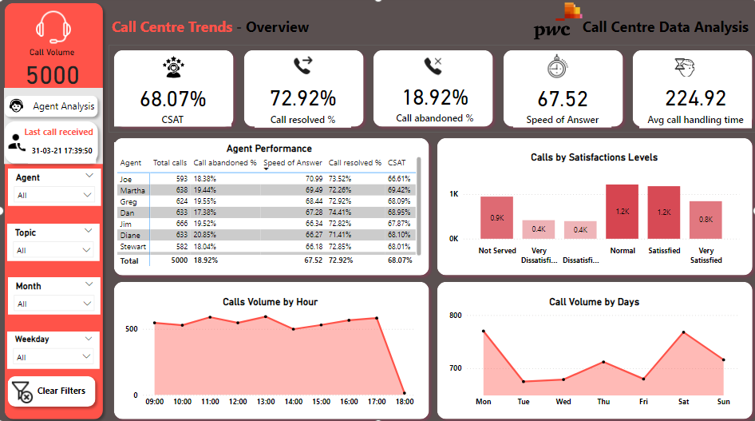

# 📞 Call Centre Analytics: Operational Performance & CSAT Insights Dashboard

A dynamic, interactive Power BI data visualization tool built to monitor call centre operations, benchmark agent efficiency, evaluate customer satisfaction, and uncover peak call traffic patterns across 5,000 customer interactions.

---

## Short Description / Purpose

The **Call Centre Analytics Dashboard** is a visually engaging and analytical Power BI report designed to help operations teams track and compare performance across **5,000 incoming customer calls** and **8 support agents**[cite: 1]. The dashboard focuses on highlighting critical service metrics like Customer Satisfaction (CSAT), call resolution rates, abandonment rates, speed of answer, and hourly/weekly traffic trends[cite: 1]. This tool is intended for use by call centre managers, operations leads, quality assurance analysts, and workforce planners who seek to optimize staffing, reduce dropped calls, and elevate customer experience[cite: 1].

---

## Tech Stack

The dashboard was built using the following tools and technologies:

* 📊 **Power BI Desktop** – Main data visualization platform used for report creation and interactive dashboard design.
* 📂 **Power Query** – Data transformation and cleaning layer for reshaping, formatting, and preparing raw call logs.
* 🧠 **DAX (Data Analysis Expressions)** – Used for calculated measures (CSAT %, Call Resolved %, Abandonment %, Average Speed of Answer, Average Handling Time) and dynamic KPI cards[cite: 1].
* 📝 **Data Modeling & Navigation** – Structured data model with interactive slicers, custom visual bookmarks (Clear Filters), and multi-page navigation (`Agent Analysis`)[cite: 1].
* 📁 **File Format** – `.pbix` for Power BI development and `.png` for dashboard previews.

---

## Data Source

* **Source:** PwC Call Centre Trends Dataset (Forage Virtual Case Experience)[cite: 1].
* **Structure:** Granular call-level dataset covering **5,000 customer calls** recorded through **March 31, 2021 (17:39:50)**, capturing agent assignments, call topics, timestamps (hour, day of week, month), call status (answered/abandoned/resolved), answer speed, call duration, and customer satisfaction ratings[cite: 1].

---

## Features / Highlights

### • Business Problem
Modern customer support centres handle thousands of daily interactions, yet managers and workforce planners often lack real-time visibility into operational bottlenecks when relying on raw call logs[cite: 1].

Key operational questions such as:
* *Which days of the week and hours of the day experience peak call surges?*
* *Why is the call abandonment rate nearly 19%, and how does it correlate with answer speed?*
* *Which agents lead in resolution and customer satisfaction, and who needs targeted coaching?*

… are difficult to diagnose quickly without consolidated visual analytics[cite: 1].

### • Goal of the Dashboard
To deliver an interactive executive and operational tool that:
* Monitors real-time service level KPIs and data freshness at a glance[cite: 1].
* Supports data-driven decisions around shift scheduling, queue management, and agent coaching[cite: 1].
* Uncovers hidden patterns across call topics, customer satisfaction tiers, and agent workloads[cite: 1].

### • Walkthrough of Key Visuals

* **Executive KPI Cards (Top Row & Left Banner)**[cite: 1]
  * **Total Call Volume:** `5,000` calls[cite: 1]
  * **Customer Satisfaction (CSAT):** `68.07%`[cite: 1]
  * **Call Resolved %:** `72.92%`[cite: 1]
  * **Call Abandoned %:** `18.92%`[cite: 1]
  * **Speed of Answer:** `67.52` seconds[cite: 1]
  * **Avg Call Handling Time:** `224.92` seconds[cite: 1]
  * **Last Call Received:** `31-03-21 17:39:50`[cite: 1]

* **Interactive Slicer & Navigation Panel (Left Sidebar)**[cite: 1]
  * Dynamic dropdown slicers allow users to slice all visuals simultaneously by **Agent**, **Topic**, **Month**, and **Weekday**, paired with a one-click **Clear Filters** reset button and an **Agent Analysis** drill-down view[cite: 1].

* **Agent Performance Scorecard (Matrix Table)**[cite: 1]
  * Ranks all **8 agents** (Jim, Martha, Dan, Diane, Greg, Joe, Stewart) across Total Calls, Call Abandoned %, Speed of Answer, Call Resolved %, and CSAT[cite: 1]. Highlights **Dan** as the top performer in resolution (`74.41%`) and lowest abandonment (`17.38%`), **Martha** as the leader in CSAT (`69.42%`), and **Diane** with the highest abandonment rate (`20.85%`)[cite: 1].

* **Calls by Satisfaction Levels (Column Chart)**[cite: 1]
  * Breaks down customer feedback into 6 tiers: **Normal** (`1.2K`), **Satisfied** (`1.2K`), **Not Served** (`0.9K`), **Very Satisfied** (`0.8K`), **Dissatisfied** (`0.4K`), and **Very Dissatisfied** (`0.4K`)—immediately exposing the volume of unserved calls impacting overall CSAT[cite: 1].

* **Call Volume by Hour (Area Chart)**[cite: 1]
  * Tracks intraday call flow from **09:00 to 18:00**, revealing sustained high demand (>500 calls/hr) throughout business hours with peaks at **11:00** and **13:00**, followed by a sharp drop-off at **18:00**[cite: 1].

* **Call Volume by Days (Area Chart)**[cite: 1]
  * Maps weekly call volume from **Monday to Sunday**, pinpointing **Monday** and **Saturday** as peak traffic days (~770 calls each) compared to quieter mid-week days like **Tuesday** and **Wednesday** (~670–680 calls)[cite: 1].

### • Business Impact & Insights

* **Workforce & Shift Optimization:** Workforce planners can reallocate agent shifts toward **Mondays, Saturdays, and the 11:00–13:00 midday rush** to absorb peak call surges and reduce the **18.92% abandonment rate**[cite: 1].
* **Targeted Agent Coaching:** Operations managers can pair agents experiencing higher abandonment or lower resolution rates (e.g., Diane, Joe) with top benchmarks (**Dan** and **Martha**) to standardize call-handling best practices[cite: 1].
* **Queue & Callback Recovery:** Addressing the **~900 "Not Served"** interactions through automated callback options or IVR routing adjustments presents an immediate lever to boost overall CSAT above 75%[cite: 1].
